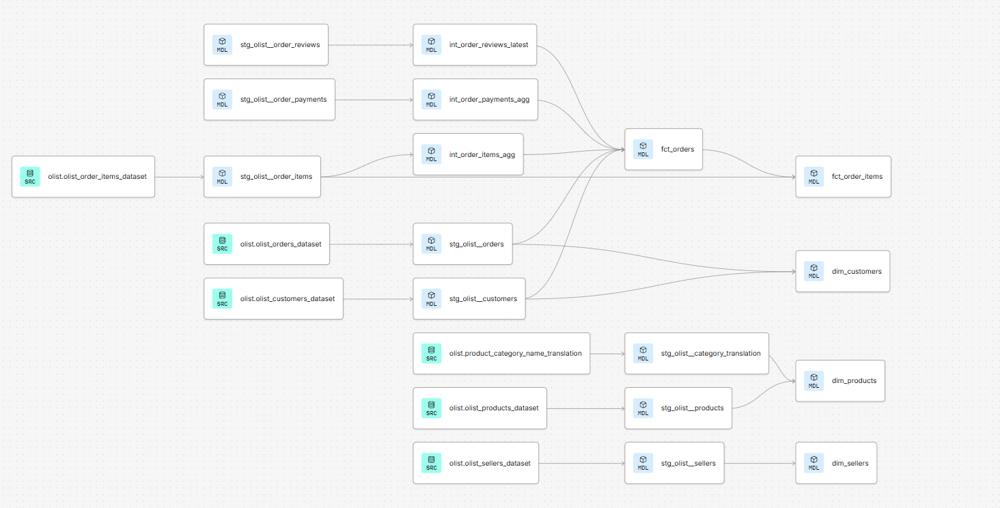

# Olist dbt project

Transforms the [Olist Brazilian E-Commerce dataset](https://www.kaggle.com/datasets/olistbr/brazilian-ecommerce)
into a tested star schema that feeds a Power BI report on delivery performance and customer satisfaction.

**Business question:** where do late deliveries hurt customer satisfaction and revenue?

## Lineage



```
raw CSVs -> staging (clean/rename, 1:1 with sources)
         -> intermediate (collapse to one row per order)
         -> marts (fct_orders, fct_order_items, dim_customers, dim_sellers, dim_products)
         -> Power BI
```

## Data issues handled

| Issue in the raw data | How it is handled |
|---|---|
| An order can have several payments (voucher + card) | `int_order_payments_agg` sums them to one row per order, so revenue is not double counted |
| An order can have several reviews, and `review_id` is not unique | `int_order_reviews_latest` keeps the most recent review per order |
| `customer_id` is per order, not per person | Customers are modelled on `customer_unique_id` in `dim_customers` |
| Some categories have no English translation | `dim_products` falls back to the Portuguese name, then `unknown` |
| A few orders are `delivered` but have no delivery date | Reported by a warn-level test instead of failing the build |
| Column typos (`product_name_lenght`) | Unused columns dropped in staging |

## Tests

- Unique / not null on all primary keys, `relationships` between facts and dimensions, `accepted_values` on status, review score and delay bucket.
- Reconciliation: total revenue in `fct_orders` must equal total revenue in `fct_order_items`.
- Sanity: no negative amounts.


## Run it

Built and run on Snowflake with dbt.

1. Run `setup/snowflake_setup.sql` and load the 8 CSVs into `OLIST.RAW`.
2. `pip install dbt-snowflake` and configure your own Snowflake connection.
3. `dbt build`, then `dbt docs generate`.


## Findings

- **Late deliveries hurt reviews:** orders delivered early average 4.29 stars, orders 8+ days late average 1.70.
- **6.8% of delivered orders arrive late** (6,535 of 96,476), and they account for R$ 985,954 (7.5%) of delivered revenue.
- **The Northeast has the worst delays:** AL (21.4%), MA (17.4%) and SE (15.2%) have late rates 2-3x the average.

Findings queries: `analyses/findings.sql`.

## Data quality

- 547 orders have several reviews, so only the latest is kept per order.
- A naive join to payments overstates revenue by about 4.5% (R$ 617K), so payments are aggregated per order first.
- 8 orders are marked `delivered` without a delivery date, flagged by a warn-level test.

## Limitations / next steps

- Geolocation table is not modelled.
